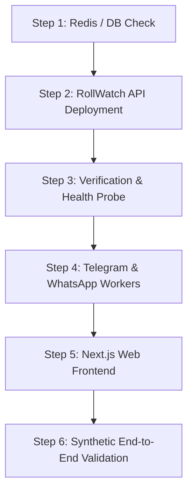

# RollWatch: Deployment & Rollback Checklist

> **Purpose:** Authoritative production deployment, health verification, and zero-downtime rollback runbook for the RollWatch platform (Next.js web app, FastAPI analytics engine, Redis session store, Telegram bot, and WhatsApp bridge).

---

## 1. Pre-Deployment Verification

Before triggering any deployment on Render, Docker, or Kubernetes, complete every item below:

### 1.1 Automated Pre-Flight Check
Run the automated verification script:
```bash
python scripts/deployment_check.py --strict
```
All critical checks must return `[PASS]`. In particular:
- [ ] **Contract Integrity:** `contracts/models.py` imports without errors and matches TRD schema.
- [ ] **Data Artifacts:** `artifacts/roll_v1.parquet`, `roll_v2.parquet`, `flags.json`, and `stories.json` exist, are non-empty, and match the target constituency.
- [ ] **Smoke Test Suite:** `python smoke_test.py` passes all 5 core checks.
- [ ] **Content Guard:** `api/guard.py` blocks partisan/inflammatory language and permits neutral analytical text.
- [ ] **Web Build:** `cd web && npm run build` compiles with zero errors and static routes pre-rendered.

### 1.2 Environment Variables & Secrets Matrix
Verify required environment variables in Render/production dashboard:

| Variable | Target Service | Purpose | Required / Default |
|---|---|---|---|
| `AUTH_SECRET` | API, Bot | HMAC secret for session tokens, JWTs, and reviewer sessions | **Required** (32+ char random) |
| `GEMINI_API_KEY` | API | Phrasing generation and claim court multimodal queries | Recommended (falls back to templates) |
| `ELEVENLABS_API_KEY` | API, Bot | Devi Hindi voice notes (TTS/STT) | Recommended (falls back to text) |
| `REDIS_URL` | API, Bot, WA | Shared state, rate-limits, and WhatsApp session bridge | Recommended (Upstash / Redis 7+) |
| `WA_WORKER_SECRET` | API, WA | Secure bridge token between API and Baileys worker | **Required** if WhatsApp enabled |
| `RAZORPAY_KEY_ID` | API, Web | Razorpay payment and subscription public key | **Required** if billing active |
| `RAZORPAY_KEY_SECRET`| API | Webhook signature verification secret | **Required** if billing active |
| `RAZORPAY_WEBHOOK_SECRET` | API | Webhook HMAC-SHA256 signature key | **Required** if billing webhooks active |
| `DEMO_MODE` | API, Web | `1` to freeze against pre-computed cache, `0` for live | Default `0` |
| `NEXT_PUBLIC_API_BASE` | Web | Base URL pointing to RollWatch API | E.g. `https://rollwatch-api.onrender.com` |

---

## 2. Production Deployment Sequence

Deploy services in the following strict order to guarantee backward compatibility and zero user disruption:



### Step 1: Redis & State Tier
1. Verify Redis connectivity: `redis-cli -u $REDIS_URL ping` -> `PONG`.
2. Ensure persistence (AOF/RDB) is active so session tokens survive restarts.

### Step 2: RollWatch API Deployment
1. Build and push container image (`Dockerfile`):
   ```bash
   docker build -t rollwatch-api:latest .
   ```
2. Deploy to Render / Cloud Run / ECS with health check path set to `/health`.
3. Set minimum 2 instances if `REDIS_URL` is configured for high availability.

### Step 3: API Verification & Health Probes
Execute immediately against the new API instance:
```bash
# 1. Health & version probe
curl -f https://rollwatch-api.onrender.com/health

# 2. Ops metrics probe
curl -f https://rollwatch-api.onrender.com/ops

# 3. Overview data verification (100 booths expected for Sampleabad)
curl -f https://rollwatch-api.onrender.com/overview | jq '.summary.total_booths'
```
Verify that HTTP status is `200` and response contains non-zero booth count.

### Step 4: Background Workers
1. Start / restart Telegram Bot worker:
   ```bash
   python -m bot
   ```
2. Verify Telegram bot heartbeat: send `/start` to `@RollWatchBot` and verify language selection prompt.
3. If WhatsApp bridge is deployed:
   ```bash
   cd wa && node worker.js
   ```
   Check `/ops/monitoring` to verify WhatsApp bridge timestamp `< 30s`.

### Step 5: Next.js Web App Deployment
1. Deploy `rollwatch-web` with `pnpm build && pnpm start`.
2. Verify cache headers on static assets:
   ```bash
   curl -I https://rollwatch-web.onrender.com/
   ```
   Check for `Cache-Control` and HTTP `200`.

### Step 6: Post-Deploy Synthetic Validation
Run synthetic user journeys through the deployed frontend and API:
- [ ] **Search:** Lookup `Meena Kumari` in Booth `B047`. Verify response mask `M**** K*****` and deletion explanation.
- [ ] **Claim Check:** Submit `"400 voters deleted in booth 47"` -> Verify verdict `Verified` with citation card.
- [ ] **Story Attribution:** Toggle context on Booth `B012` (Hostel) -> Verify unexplained drops to 0.
- [ ] **Pricing:** Load `/pricing` -> Verify custom quote calculator recalculates cleanly.

---

## 3. Rollback Runbook (Zero-Downtime)

### 3.1 Rollback Triggers (P0 / P1 Incidents)
Trigger an immediate rollback if ANY of the following occur within 15 minutes of deploy:
1. **API Error Spike:** 5xx response rate exceeds 1% over 2 consecutive minutes.
2. **P95 Latency Degradation:** API p95 latency exceeds 2,500ms on `/overview` or `/citizen/ask`.
3. **Data Anomaly:** `/overview` returns 0 booths or missing flags.
4. **Worker Failure:** Telegram or WhatsApp fails to respond for > 60 seconds.
5. **Guard Regression:** Guard fails to block a known partisan string or blocks neutral text.

### 3.2 Instant Rollback Procedure

#### Tier 1: Web App Rollback (Render / Vercel)
1. Go to Render Dashboard -> `rollwatch-web` -> **Deploys**.
2. Select previous known-good deploy and click **Rollback to this deploy**.
3. *Expected time to restore:* < 30 seconds (instant traffic reroute).

#### Tier 2: API Service Rollback
1. Go to Render Dashboard -> `rollwatch-api` -> **Deploys**.
2. Select previous stable Docker release -> **Rollback**.
3. If using Docker CLI:
   ```bash
   docker stop rollwatch-api
   docker run -d --name rollwatch-api -p 8000:8000 --env-file .env rollwatch-api:previous-stable
   ```
4. Verify `/health` immediately.

#### Tier 3: Redis & State Recovery
- Session tokens in Redis are backward-compatible.
- If Redis data was corrupted or poisoned:
  ```bash
  # Flush rate-limit keys without clearing session store
  redis-cli -u $REDIS_URL --scan --pattern "rw:rl:*" | xargs redis-cli -u $REDIS_URL del
  ```

#### Tier 4: Background Workers
- Terminate failed worker processes and restart with previous git commit / container image.
- Confirm connection recovery in `/ops/monitoring`.

---

## 4. Post-Rollback Post-Mortem Checklist
- [ ] Capture all error logs from Render / stdout / `ops.jsonl`.
- [ ] Preserve git hash of failed build.
- [ ] Replicate error in local environment (`.venv\Scripts\python.exe -m engine.run` / `pytest`).
- [ ] Document root cause and add regression check to `smoke_test.py` or `scripts/deployment_check.py`.
